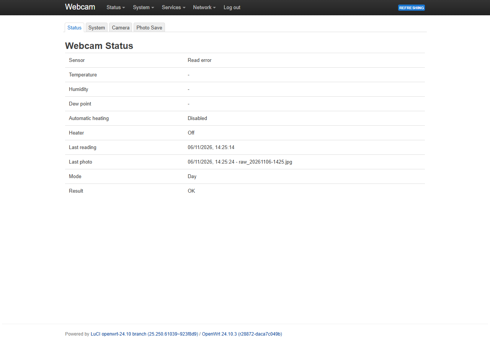
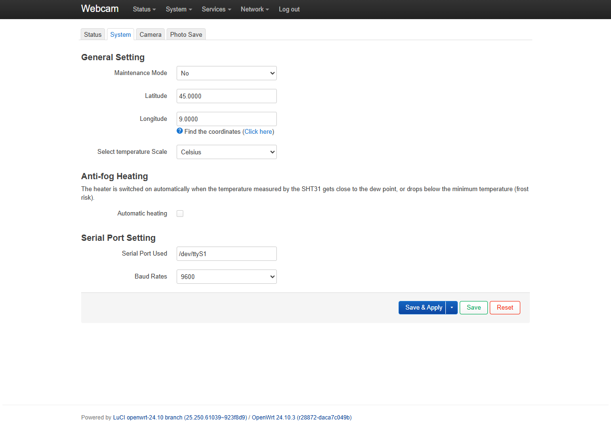
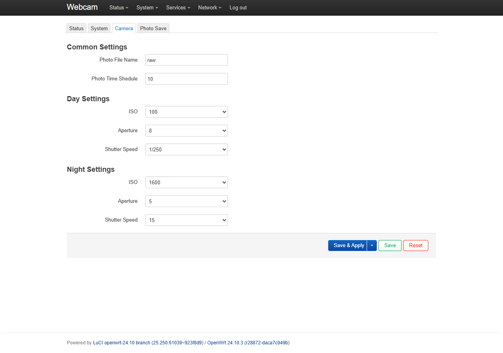
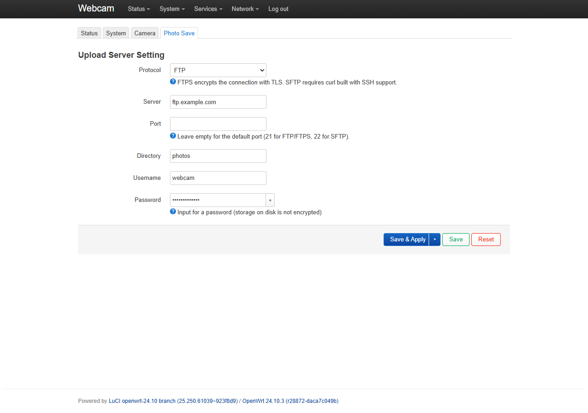

# luci-app-webcam

App LuCI per OpenWrt che trasforma un piccolo router (testata su **GL.iNet GL-MT300N-V2**) in una webcam time-lapse con una reflex **Canon EOS** collegata via USB.

- Scatta a intervalli regolari con **gPhoto2**, con impostazioni diverse per **giorno** e **notte**. Alba e tramonto sono calcolati in locale dalle coordinate.
- Carica ogni foto sul **portal Webcam 2.0** (HTTPS, con SHA-256 e dati `photo/1`), su un server **FTP**, **FTPS** o **SFTP**, o su entrambi.
- Ogni 5 minuti raccoglie la **telemetria** (clima, Victron, rete e segnale 4G, memoria, spazio, coda) e la manda al portal ogni 30 minuti; errori, riavvii e aggiornamenti diventano **eventi**. Tutto finisce nel database MariaDB del portal ([webcam-portal](https://github.com/Millorco/webcam-portal), contratto dei dati in `docs/contratto/`).
- Esegue i **comandi del portal** (1.2.0) da una lista chiusa: riscaldamento acceso per un tempo (boost), scatto, invio della telemetria, sette opzioni del riscaldamento e dello scatto. Ogni comando torna al portal con il suo esito.
- Conta scatti, ore di accensione e riavvii della reflex e legge, se c'è, un regolatore solare **Victron** (VE.Direct).
- Insieme a una scheda dedicata (ATmega328P) collegata in seriale:
  - comanda i relè di fotocamera, router, riscaldamento e ventola;
  - legge un sensore **SHT31/SHT35** dentro il case (e, se c'è, un secondo SHT31 fuori) e accende il riscaldamento per evitare condensa e brina sul vetro del case;
  - fa da **watchdog**: se il router smette di rispondere, toglie e ridà corrente a router e fotocamera.
- Se la fotocamera si blocca, la riavvia da sola tramite il relè.
- Avvisa tramite [Uptime Kuma](https://github.com/louislam/uptime-kuma) (o [healthchecks.io](https://healthchecks.io)) quando una webcam smette di caricare foto, e può mandare i log di tutti i router a un unico server (vedi [webcam-logserver](https://github.com/Millorco/webcam-logserver)).



## Indice

- [Hardware](#hardware)
- [Installazione](#installazione)
- [Configurazione](#configurazione)
- [Come funziona](#come-funziona)
- [Scheda relè e sensore](#scheda-relè-e-sensore)
- [Portal, telemetria ed eventi (1.1)](#portal-telemetria-ed-eventi-11)
- [Comandi del portal (1.2)](#comandi-del-portal-12)
- [Monitoraggio e log centralizzati](#monitoraggio-e-log-centralizzati)
- [Risoluzione dei problemi](#risoluzione-dei-problemi)
- [Struttura del progetto](#struttura-del-progetto)

## Hardware

| Componente | Note |
|---|---|
| Router OpenWrt | GL.iNet GL-MT300N-V2 (MT7628). Usa la seconda UART (`/dev/ttyS1`, pad TX1/RX1) per la scheda. |
| Fotocamera | Canon EOS 2000D / 1500D (altre EOS supportate da gPhoto2 dovrebbero funzionare). |
| Scheda "Webcam Board 1.0" | ATmega328P a 16 MHz, 3 relè (fotocamera, router, riscaldamento), uscita ventola, traslatori di livello 5 V ↔ 3,3 V verso il router, convertitori per 5 V e alimentazione fotocamera. |
| Sensori | SHT31 o SHT35 interno su I2C all'indirizzo **0x44** (pin ADDR a GND). Facoltativo: un secondo SHT31 per esterno (es. DFRobot SEN0385) all'indirizzo **0x45** (ADDR a VCC), sullo stesso bus. Il riscaldamento e le sue protezioni usano solo il sensore interno. |

Collegamenti principali:

| Connettore scheda | Pin | Collegamento |
|---|---|---|
| **TX1** (verso il router) | 1 VCC · 2 RX1OUT · 3 TX1OUT | VCC = 3,3 V del router · RX1OUT → TX1 del router · TX1OUT → RX1 del router. La massa arriva dall'alimentazione. |
| **TEMP** (sensori) | 1 5V · 2 GND · 3 SCL · 4 SDA | Attenzione ai moduli **Grove**, che hanno un ordine diverso (SCL, SDA, VCC, GND): serve un cavo rimappato. Con due sensori i 4 fili vanno in parallelo (sdoppiatore o morsettiera). |
| **FTDI** (debug e programmazione) | 1 GND · 2 TX · 3 RX · 4 5V · 5 DTR | TX → RXD dell'adattatore, RX → TXD dell'adattatore. |

## Installazione

Sul router, via SSH:

```sh
wget https://raw.githubusercontent.com/Millorco/luci-app-webcam/main/install.sh
chmod +x install.sh
./install.sh
```

Lo script:
1. mostra le release disponibili e chiede quale installare;
2. installa o aggiorna le dipendenze (`gphoto2`, `libgphoto2-drivers-ptp2`, `curl`, `ca-bundle` per l'HTTPS del portal, `coreutils-stty`, e per la VPN `wireguard-tools`, `kmod-wireguard`, `luci-proto-wireguard`), con opkg o con apk (OpenWrt 25.12+);
3. copia i file. Se esiste già una configurazione, chiede se sovrascriverla;
4. abilita e avvia il servizio `webcam_capture`. Il servizio aggiunge al crontab di root, senza toccare gli altri job, l'heartbeat (ogni 3 minuti), il controllo anti-appannamento e il campione di telemetria (ogni 5 minuti), l'invio della telemetria (ogni 30 minuti), l'inventario (ogni 6 ore) e il controllo dei comandi del portal (`commands --due`, ogni minuto: non legge la configurazione e non fa richieste se il portal non le ha chieste). Imposta anche `cronloglevel` a 9 in `/etc/config/system`, così crond non scrive più nel log una riga a livello errore per ogni job eseguito.
5. spegne tutti i LED del router (`add_led_config`), così non si riflettono nella foto: per ogni LED in `/sys/class/leds` imposta in `/etc/config/system` trigger `none` e luminosità 0, quindi restano spenti anche dopo il riavvio. Chi aggiorna estraendo l'archivio della release ottiene lo stesso al riavvio successivo, tramite `/etc/uci-defaults/90-webcam-leds`. Per tenerli accesi: `uci set webcam.general.leds_off=0; uci commit webcam` prima di installare, poi riaccenderli da **Sistema → Configurazione LED**.
6. dà al router un **hostname unico** se ha ancora quello predefinito (`OpenWrt`, `LEDE`, `GL-MT300N-V2` o un altro `GL-…`): `WC-<MAC in maiuscolo senza :>`, per esempio `WC-9483C412ABCD`, uguale al ref della webcam in Dolibarr. VictoriaLogs riconosce la webcam solo dall'hostname e il portal usa i log di una webcam solo se il suo hostname è unico; con l'hostname predefinito, uguale per tutti i router, i log non si possono attribuire. Il MAC è quello della prima scheda fisica (`eth0`), lo stesso dell'inventario e del portal. Un hostname già cambiato dall'utente (es. `monte-cavo`) non si tocca. Chi aggiorna estraendo l'archivio ottiene lo stesso al riavvio, tramite `/etc/uci-defaults/91-webcam-hostname`. L'hostname scelto va scritto anche nella webcam del portal (`webcams.hostname`).

Dopo l'installazione, con la fotocamera collegata e accesa, genera gli elenchi di ISO, diaframmi e tempi che compaiono nei menu di LuCI:

```sh
iso_export; aperture_export; shutterspeed_export
```

L'elenco dei diaframmi dipende dall'obiettivo e dallo zoom: rilancia `aperture_export` se li cambi.

## Configurazione

Le pagine sono in **Servizi → Webcam**. La configurazione è salvata in `/etc/config/webcam`.

### Status

Mostra la versione dell'app e del firmware della scheda (letta con il comando `v`), temperatura, umidità e punto di rugiada interni (ed esterni, se c'è il secondo sensore), stato del riscaldamento con il motivo (punto di rugiada, temperatura minima, boost dal portal, spento per lo scatto) e da quando è acceso, percentuale di accensione nell'ultima ora, **boost** del riscaldamento comandato dal portal (attivo fino a, oppure trattenuto dalle protezioni), ultimo scatto (giorno/notte) ed esito dell'upload. Si aggiorna ogni 30 secondi; i dati della scheda ogni 5 minuti.

Accanto alle versioni dell'app e del firmware compare *version X available* se ne esiste una più recente, con il link alla release o al firmware. La riga **Update check** dice quando è stato fatto l'ultimo controllo e ha il pulsante **Check now**. Il controllo (`check_updates`) scarica [`latest.json`](latest.json) solo con la pagina Status aperta, al massimo ogni 12 ore (ogni ora dopo un errore), in background e con un timeout di 20 secondi. Senza internet la pagina resta com'è e mostra l'ultimo risultato riuscito. Il firmware della scheda va comunque aggiornato a mano dall'FTDI.

A ogni nuova release aggiorna `app` e `app_url` in `latest.json` (e `fw`, `fw_url` quando cambia `FW_VERSION` in `board.ino`), e la sua copia se usi un *Update info URL*. Quando pubblichi la release, la action `.github/workflows/release.yml` controlla che il tag corrisponda a `root/usr/share/webcam/version` e allega da sola l'archivio `luci-app-webcam-<versione>.tar.gz`.

Sotto la tabella ci sono tre pulsanti:

- **Take photo now**: scatta subito con le impostazioni attuali e carica la foto come uno scatto normale.
- **Test shot (no upload)**: scatta ma non carica nulla, per provare esposizione e messa a fuoco.
- **Show last photo**: mostra l'ultima foto rimasta sul router.

Funzionano anche in modalità manutenzione. Dopo lo scatto la pagina mostra l'anteprima e un link alla foto a piena risoluzione. La foto resta in `/tmp/webcam/photo` solo fino allo scatto successivo, e l'anteprima scarica il file originale, quindi con una reflex da 24 MP può impiegare qualche secondo. Se uno scatto è già in corso (anche quello programmato), il pulsante lo segnala e non ne avvia un altro.

### System



- **Maintenance Mode**: con *Yes* il servizio non scatta. Dopo l'installazione è attivo: mettilo su *No* quando hai finito di configurare.
- **Latitudine / Longitudine**: servono per calcolare alba e tramonto.
- **Wait for NTP**: minuti massimi di attesa della sincronizzazione dell'ora dopo un riavvio (predefinito 30, 0 = senza limite). Vedi [Ora dopo un riavvio](#ora-dopo-un-riavvio).
- **Temperature scale**: °C o °F nella pagina Status.
- **Outside sensor**: da attivare se c'è il secondo SHT31 fuori dal case (0x45, firmware 2.3 o successivo). I suoi valori vanno nella pagina Status, nel `.json` di ogni foto e nell'inventario.
- **Anti-fog Heating**: abilita il controllo automatico e ne imposta le soglie (margine dal punto di rugiada, temperatura minima, isteresi, ventola insieme al riscaldamento).
- **Monitoring**: URL Push di Uptime Kuma (o ping URL di healthchecks.io) e indirizzo dell'inventario delle webcam, vedi [Monitoraggio e log centralizzati](#monitoraggio-e-log-centralizzati).
- **Check for updates** / **Update info URL**: attiva il controllo degli aggiornamenti della pagina Status e indica da dove leggere le ultime versioni. Vuoto = `latest.json` su GitHub. Con il repository privato il router non può leggerlo, quindi metti una copia del file su un server raggiungibile (per esempio il proprio sito) e scrivi qui il suo indirizzo.
- **Serial Port**: `/dev/ttyS1` a 9600 baud per la scheda.

### Camera



- **Photo File Name**: prefisso del file (`<prefisso>_AAAAMMGG-HHMM.jpg`).
- **Photo Time Schedule**: intervallo tra gli scatti, in minuti.
- **Sunrise / Sunset offset**: minuti (anche negativi) che spostano il passaggio tra impostazioni diurne e notturne. Con *−30* e *+30* le impostazioni diurne valgono da mezz'ora prima dell'alba a mezz'ora dopo il tramonto, quando il cielo è ancora chiaro e le impostazioni notturne brucerebbero la foto.
- **Special capture times**: fasce orarie con un intervallo diverso, per esempio ogni minuto dalle 23:50 alle 00:10 di Capodanno, o più fitto al tramonto. Per ogni fascia: data (vuota = ogni giorno, `MM-GG` = ogni anno, `AAAA-MM-GG` = una volta sola), inizio e fine `HH:MM` e intervallo in minuti. L'intervallo sostituisce quello normale, quindi può anche diradare gli scatti (es. ogni 30 minuti di notte); se più fasce si sovrappongono vale la più fitta. Una fascia che passa la mezzanotte appartiene al giorno in cui inizia. Il servizio si sveglia all'inizio e alla fine di ogni fascia, così il primo scatto non arriva in ritardo.
- **Day / Night Settings**: ISO, diaframma e tempo. *Camera setting (do not change)* lascia l'impostazione della fotocamera, comodo in modalità P o Av. Il tempo **bulb** non viene mai applicato.

Consigli per una webcam fissa:
- **Messa a fuoco manuale**: metti a fuoco una volta sulla scena, poi sposta l'interruttore dell'obiettivo su **MF**. In AF la fotocamera rifiuta lo scatto ("PTP Device Busy") quando non riesce a mettere a fuoco, per esempio con nebbia o di notte.
- **Esposizione**: con la ghiera su **M** imposta valori espliciti per giorno e notte. Alla prima installazione sono già impostati giorno 1/500, f/8, ISO Auto (la fotocamera regola gli ISO alla luce, da sole pieno a cielo coperto) e notte 15", diaframma più aperto (f/5 con l'obiettivo di riferimento), ISO 1600. I valori sono gli indici delle scelte di gphoto2 di una Canon EOS: dopo `iso_export; aperture_export; shutterspeed_export` controlla in **Camera Setting** che corrispondano ancora, soprattutto il diaframma, che dipende dall'obiettivo. Con **Av/P** metti i campi su *do not change*.

### Portal

Pagina nuova della 1.1, vedi [Portal, telemetria ed eventi](#portal-telemetria-ed-eventi-11).

- **Portal URL** / **Portal token**: indirizzo base del portal, senza `/api/v1` (es. `https://portal.viewlapse.com`; in prova su XAMPP `http://IP-DEL-PC/webcam-portal`) e token della webcam (`wct_…`), generato dal portal quando l'operatore crea la webcam. **Test connection** chiama `GET /api/v1/whoami` (anche da SSH: `portal_check`).
- **Photo destination**: *Automatic* (predefinito: solo portal se c'è il Portal URL, altrimenti FTP come nella 1.0), *Portal only*, *FTP only*, *Portal and FTP* (doppio upload: in 4G raddoppia il traffico).
- **Send telemetry**: campione ogni 5 minuti, invio ogni 30.
- **Accept portal commands** (1.2.0, attivo di default): il router chiede ed esegue i comandi del portal, vedi [Comandi del portal](#comandi-del-portal-12). Sotto la pagina, **Portal commands** mostra gli ultimi 30 comandi ricevuti dall'avvio (ora, tipo, id, richiesta che li ha portati, esito e motivo) e il pulsante **Check for commands now** (`GET /api/v1/commands`).
- **Victron solar charger**: lettura facoltativa (disattivata di default) di un MPPT SmartSolar dal cavo VE.Direct-USB (porta, es. `/dev/ttyUSB0`, serve `kmod-usb-serial-ftdi`), e di uno **SmartShunt** facoltativo su una seconda porta (es. `/dev/ttyUSB1`) da cui viene la percentuale di carica. Con fotocamera e cavi Victron serve un hub USB alimentato.
- **4G modem**: dati radio da modem QMI (`uqmi`), ModemManager (`mmcli`) o chiavetta **HiLink** (es. Huawei E3372h-320, interfaccia `cdc_ether`, gateway `192.168.8.1`) letta dalla sua API locale; si può disattivare o cambiare indirizzo.
- **Initial shot count**: valore iniziale del contatore degli scatti (le EOS 2000D/1500D non dicono il loro `shuttercounter`: leggilo una volta con un programma da PC). Si applica una volta, quando lo cambi.

### Photo Save



- **Protocol**: FTP, FTPS (FTP su TLS, consigliato se il server lo supporta) o SFTP. SFTP richiede un `curl` compilato con libssh2: verifica con `curl -V`.
- **Server, porta, cartella, utente e password**. Per SFTP si può indicare una chiave privata al posto della password.
- **Skip certificate check**: solo per certificati self-signed. Se il certificato è valido ma intestato a un altro nome (tipico degli hosting condivisi), usa come server il nome presente nel certificato.

Archivio e file aggiuntivi (alla prima installazione sono tutti attivi, con la copia chiamata `current`):

- **Folders by date**: salva ogni foto in `<cartella>/AAAA/MM/GG/`, create in automatico. È lo schema usato da foto-webcam.eu e da gallerie pronte come [webcam.php](https://github.com/cloveras/webcam).
- **Upload a copy as latest photo**: carica la foto anche come `<cartella>/current.jpg` (nome modificabile), sostituita a ogni scatto, comoda da mostrare in una pagina web. Viaggia come `current.jpg.part` e viene rinominata solo a upload finito, quindi chi apre la pagina vede sempre una foto intera (per un istante, tra la cancellazione della vecchia e la rinomina, il file può mancare). La foto viene inviata due volte, quindi il traffico raddoppia. Se solo la copia fallisce, l'esito nella pagina Status lo dice ma la foto in archivio resta caricata.
- **Upload data file**: accanto a ogni foto carica sull'FTP un `.json` con lo stesso nome, e `current.json` se è attiva la copia. Dalla 1.1 è nel formato **`photo/1`** del contratto (con il portal il file si scrive sempre, perché viaggia con la foto). I campi della 1.0 restano tutti con lo stesso nome; si aggiungono `schema`, `time_synced`, `mac`, `hostname`, `sha256`, `size`, `interval`, `lat`, `lon`, `board_fw`, `capture`, `camera_info`, `power`. Esempio:

```json
{
  "schema": "photo/1",
  "time": 1795012200,
  "datetime": "2026-11-18T15:30:00+0100",
  "time_synced": true,
  "mac": "94:83:c4:12:ab:cd",
  "hostname": "monte-cavo",
  "camera": "monte-cavo",
  "file": "raw_20261118-1530.jpg",
  "sha256": "75b70e70f3d3b6b476116a8185ab83d02e1550c9963cc2e4e36627c0f5cbbbaf",
  "size": 7340112,
  "mode": "day",
  "special": null,
  "interval": 10,
  "settings": { "iso": "Auto", "aperture": "8", "shutterspeed": "1/500" },
  "day_start": 1794981660,
  "day_end": 1795017120,
  "lat": 41.929308,
  "lon": 12.464880,
  "app_version": "1.1.0",
  "board_fw": "2.3",
  "capture": { "attempts": 1, "camera_power_cycled": false, "duration_s": 9 },
  "camera_info": { "model": "Canon EOS 2000D", "serial": "123456789012", "firmware": "1.0.1",
                   "lens": "EF-S18-55mm f/3.5-5.6 III", "shutter_count": null, "battery_level": "100%",
                   "read_at": 1795010400 },
  "climate": { "time": 1795012080, "sensor_ok": true, "temperature": 14.2, "humidity": 61.5,
               "dewpoint": 6.9, "abs_humidity": 7.50, "ext_sensor": true, "ext_sensor_ok": true,
               "temperature_ext": 9.7, "humidity_ext": 83.0, "dewpoint_ext": 7.0, "abs_humidity_ext": 7.64,
               "heating_enabled": true, "heater": false, "fan": false, "board_fw": "2.3" },
  "power": null
}
```

  `null` nelle impostazioni significa "lasciata quella della fotocamera". `time_synced` è `false` se lo scatto è avvenuto prima della sincronizzazione NTP (la foto si carica lo stesso, ma non vale per le statistiche certificate). `camera_info` si legge con gphoto2 al massimo una volta l'ora. `day_start`/`day_end` sono alba e tramonto già spostati dagli offset. `climate` è l'ultima lettura di `climate` (null se più vecchia di 15 minuti). Con questi file il server può fare grafici, sovrimpressioni o allarmi senza interrogare il router.

Coda offline:

- **Queue size (MB)**: le foto che non si riescono a caricare (4G assente, server giù) restano sul router e vengono ritentate agli scatti successivi, dopo la foto nuova e dalla più vecchia, ognuna nella cartella del giorno in cui è stata scattata. Ogni giro dedica alla coda al massimo metà intervallo (e non più di 5 minuti), e si ferma al primo upload fallito. Quando la coda supera il limite, o nel filesystem restano meno di 8 MB liberi, vengono cancellate le foto più vecchie; la più recente resta sempre. Predefinito 20 MB, 0 disattiva la coda. La pagina Status mostra quante foto sono in attesa.
- **Code per destinazione**: con il portal le foto in attesa stanno in `<coda>/portal/`, quelle per l'FTP nella coda come prima; una foto che aspetta entrambe le destinazioni è un collegamento fisico, quindi non occupa spazio due volte. Le foto rifiutate dal portal (dati non validi, troppo grandi, SHA-256 diverso due volte) vanno in `<coda>/rejected/` con un `.txt` che dice il motivo, al massimo 20.
- **Queue folder**: vuota = `/tmp/webcam/queue`, in RAM, persa a ogni riavvio. Con 128 MB di RAM ci stanno due o tre foto da 24 MP. Per una coda più lunga usa una chiavetta USB: crea prima la cartella (es. `/mnt/sda1/webcam-queue`) e indicala qui. Se la cartella non esiste, per esempio perché la chiavetta non è montata, la coda torna in RAM, così non si scrive nella flash del router.

### Ora dopo un riavvio

Il GL-MT300N-V2 non ha un orologio a batteria: dopo ogni riavvio, compresi i cicli del watchdog e i blackout, l'ora riparte da quella dell'ultimo file salvato in flash. Per non caricare foto con data vecchia, che finirebbero nella cartella sbagliata e potrebbero sovrascrivere sul server una foto con lo stesso nome, all'avvio `capture_service` non scatta finché `sysntpd` non ha sincronizzato l'ora. Lo segnala `/etc/hotplug.d/ntp/25-webcam`, che crea `/var/run/webcam_ntp_synced`.

- Se dopo *Wait for NTP* minuti l'ora non è ancora sincronizzata, scatta comunque, lo scrive nel log (e nel registro del check, se usi healthchecks.io).
- Se l'anno è precedente al 2025 l'ora è sicuramente sbagliata: non scatta finché non arriva NTP, e anche "Take photo now" rifiuta l'upload (lo scatto di prova funziona).
- Se il client NTP è disattivato in *Sistema → Sistema → Sincronizzazione dell'ora*, non aspetta. Lascialo attivo.

## Come funziona

- **`capture_service`** (servizio procd `webcam_capture`): all'avvio aspetta che l'ora sia sincronizzata con NTP, poi ogni *Photo Time Schedule* minuti lancia `capture`, salvo in modalità manutenzione. Durante una fascia speciale usa l'intervallo della fascia (calcolato da `/usr/libexec/webcam/schedule`).
- **`capture`**:
  1. decide se è giorno o notte con `sun_times`, applicando gli offset di alba e tramonto;
  2. spegne il riscaldamento durante lo scatto, per avere abbastanza corrente;
  3. scatta con gphoto2 usando `--set-config-index`;
  4. se lo scatto fallisce, spegne e riaccende la fotocamera tramite la scheda e riprova una volta;
  5. mette la foto nella coda offline e la carica (in `AAAA/MM/GG/` se richiesto) con il suo `.json` dei dati, poi la copia `current.jpg` con nome temporaneo e rinomina;
  6. se l'upload è riuscito toglie la foto dalla coda e ritenta quelle arretrate, poi scrive l'esito e il numero di foto in coda in `/tmp/webcam/capture.json`.
- **`climate`** (cron, ogni 5 minuti): legge T e RH, calcola il punto di rugiada (formula di Magnus) e accende riscaldamento e ventola se `T − Td` è sotto il margine o `T` è sotto la minima, con isteresi per lo spegnimento. Con un **boost** del portal (`/tmp/webcam/heater_boost_until`) tiene acceso il riscaldamento fino all'ora indicata, salvo le protezioni: niente boost con *Anti-fog Heating* spento, con il sensore interno muto o oltre 40 °C interni (la scheda spegne comunque a 45 °C e dopo 20 minuti senza `H`). Lo stato va in `/tmp/webcam/status.json`, dalla 1.2.0 con `heat_reason`, `heater_on_since` (ora di modifica di `/tmp/webcam/heater`, riscritto solo ai cambi), `heater_duty_pct` (giri da cron con il riscaldamento acceso negli ultimi 60 minuti, in `/tmp/webcam/heater_duty`), `heater_boost_until` e `dewpoint_margin`. `climate --now` (comandi, fine del boost) aggiorna subito senza contare nella percentuale. Un giro alla volta (lock). Se il sensore interno non risponde, lo stato del riscaldamento resta invariato. Con *Outside sensor* attivo legge anche il sensore esterno (comandi `T`/`U`) e ne calcola il punto di rugiada, solo come informazione.
- **`heartbeat`** (cron, ogni 3 minuti): invia `b` alla scheda. Dopo 10 minuti senza heartbeat la scheda spegne e riaccende router e fotocamera.
- **Livelli di log**: `capture` e `capture_service` scrivono le righe `ERRORE` a livello err, `ATTENZIONE` a warning, `OK foto caricata` e `OK caricate N foto rimaste in coda` a info, il resto a notice. Ogni `ERRORE` dice la causa: fotocamera non trovata su USB, scatto fallito (USB occupata, messa a fuoco, scheda di memoria, comunicazione), memoria del router piena, chiavetta della coda non montata, upload fallito (rete giù, DNS, credenziali, server spento, certificato, spazio o permessi sul server), sensore che non risponde, invio all'inventario non riuscito. Nel server dei log (VictoriaLogs) si filtrano con `level:error` o `level:info`.
- **`/usr/libexec/webcam/serial`**: unico punto di accesso alla seriale, con lock e una pausa di 2 secondi tra un comando e l'altro.

## Scheda relè e sensore

Firmware: [`board.ino`](board.ino) (versione 2.3).

### Protocollo

9600 baud 8N1, un carattere per comando, senza terminatore. Funziona uguale dal router e dall'FTDI.

| Comando | Azione | Risposta |
|---|---|---|
| `b` | heartbeat | — |
| `C` / `c` | fotocamera ON / OFF | — |
| `H` / `h` | riscaldamento ON / OFF | — |
| `P` / `p` | router ON / OFF | — |
| `F` / `f` | ventola ON / OFF | — |
| `t` | temperatura interna (0x44) | es. `21.4`, oppure `ERR` |
| `u` | umidità interna (0x44) | es. `55.0`, oppure `ERR` |
| `T` | temperatura esterna (0x45, dal fw 2.3) | es. `4.1`, oppure `ERR` |
| `U` | umidità esterna (0x45, dal fw 2.3) | es. `95.0`, oppure `ERR` |
| `d` | test connessione | `OK` |
| `r` | ciclo di alimentazione di router e fotocamera (5 s) | — |
| `s` | stato su una riga | `S fw=2.3 camera=1 heating=0 pc=1 fan=0 sht=1 T=… H=… sht2=1 T2=… H2=… hb_age=… wd=1 cycles=…` |
| `v` | versione | `Webcam Board fw 2.3` |
| `?` | elenco comandi | — |
| `i` | *(solo FTDI)* scansione del bus I2C | — |
| `w` / `W` | *(solo FTDI)* sospende per 60 minuti / riattiva il watchdog dell'heartbeat | — |

Sicurezze integrate nel firmware:
- **Riscaldamento e ventola** si spengono da soli se `H`/`F` non vengono ripetuti entro 20 minuti (`climate` li reinvia ogni 5). Il riscaldamento si spegne anche oltre i 45 °C o se il sensore resta muto.
- **Router che non riparte**: i cicli di alimentazione si diradano (10, 20, 40 minuti, fino a 2 ore).
- **Bus I2C**: ha un timeout, quindi un sensore guasto non blocca la scheda.
- **Watchdog hardware AVR** a 8 secondi.

### Programmazione

1. Arduino IDE: scheda **Arduino Uno**, libreria **Adafruit SHT31** (con Adafruit BusIO).
2. Su un chip nuovo, o se l'FTDI non riesce a caricare, scrivi prima il bootloader dal connettore **ICSP** (USBasp o "Arduino as ISP", *Strumenti → Scrivi il bootloader*). Poi carica lo sketch dall'FTDI, oppure direttamente con il programmatore.

### Debug

Apri il monitor seriale sull'FTDI a **9600 baud**, senza fine riga.

All'avvio la scheda stampa:
- la versione;
- la causa del reset (accensione, RESET/DTR, brown-out, watchdog);
- i livelli di SDA/SCL;
- la scansione I2C;
- lo stato del sensore.

Poi registra con timestamp ogni comando ricevuto e ogni cambio dei relè, e ogni minuto stampa una riga di stato.

## Portal, telemetria ed eventi (1.1)

Formati e API sono nel contratto dei dati del repository [webcam-portal](https://github.com/Millorco/webcam-portal) (`docs/contratto/`): `photo/1`, `telemetry/1`, `event/1`, `api-portal-v1.md`. Il router si autentica con il token della webcam (`Authorization: Bearer wct_…`, passato a curl dallo standard input, non sulla riga di comando) e manda `User-Agent: luci-app-webcam/<versione>`.

- **Foto**: `POST /api/v1/photo` (multipart: JPEG + JSON). Il portal riconosce un secondo invio dallo SHA-256, quindi riprovare è sempre sicuro. Codici: 200/201 la foto esce dalla coda; 400/413/415 va in `rejected/`; 422 un solo nuovo tentativo, poi `rejected/`; 401/403/409 resta in coda con un `ERRORE` nel log (token o MAC sbagliati); 429 si aspetta il `Retry-After`; errori di rete e 5xx si riprova al giro dopo.
- **Telemetria**: `telemetry_sample` (cron ogni 5 minuti, dopo `climate`) scrive un campione con id `<boot_id>-<seq>` in `/tmp/webcam/telemetry/` (o `<queue_dir>/telemetry`), al massimo 2016 campioni (7 giorni) e senza togliere a `/tmp` gli ultimi 4 MB; oltre si scartano i più vecchi con l'evento `telemetry.dropped`. `telemetry_send` (cron ogni 30 minuti, ritardo casuale fino a 2 minuti) manda lotti fino a 288 campioni, compressi con gzip, e li toglie dalla coda solo con la risposta 200; con 413 dimezza il lotto. Prima dell'invio corregge l'ora dei campioni presi prima di NTP nello stesso avvio (`time_corrected`). `telemetry_sample --print` e `telemetry_send --print` mostrano cosa viene inviato.
- **Contenuto del campione**: `climate` (lo `status.json` di `climate`, ora con `abs_humidity`, `abs_humidity_ext` e `fan`; dalla 1.2.0 anche i campi per la diagnosi del contratto 1.1: `heater_on_since`, `heater_duty_pct`, `heat_reason`, `heater_boost_until`, `dewpoint_margin`; `fan_rpm` no, la scheda non ha il tachimetro), `power` (Victron), `net` (interfaccia WAN, tipo, traffico dall'avvio, IP, VPN attiva, e se il modem li dà operatore, RSSI, RSRP, RSRQ, SINR), `sys` (carico, memoria, spazio in `/tmp` e `/overlay`, foto e campioni in coda, manutenzione), `camera` (vista su USB, relè acceso; dalla 1.2.0 `scheduled`, falso in manutenzione o con `capture_service` fermo, e `interval_min`, l'intervallo in vigore con le fasce speciali). Il lotto porta anche i contatori della reflex.
- **Eventi**: `/usr/libexec/webcam/event` li mette in coda (`/tmp/webcam/events`, al massimo 500) e li manda subito a `POST /api/v1/event`; se manca la rete partono con `telemetry_send`. La riga di log resta come prima. Tipi: `boot`, `service.start`, `app.version_change`, `board.version_change`, `ntp.synced`, `camera.power_cycle`, `camera.error`, `camera.missing`, `camera.change`, `upload.error` (FTP), `queue.dropped`, `telemetry.dropped`, `sensor.error`/`sensor.ok`, `heating.on`/`heating.off` (dalla 1.2.0 con `reason`), `power.error` (Victron), `maintenance.on`/`maintenance.off`, e dalla 1.2.0 `command.ack` e `config.change` (opzione cambiata da un comando del portal).
- **Contatori della reflex**: `shots_total` (scatti riusciti, anche quelli di prova), ore con il relè della fotocamera acceso, riavvii dal relè ed errori di scatto. Sono in `/tmp/webcam/counters` e vengono copiati in `/etc/webcam/counters` (flash) al massimo una volta l'ora e all'arresto del servizio, per non consumare la flash: dopo un'interruzione di corrente si perde al più un'ora. Ripartono da 0 quando cambia il numero di serie della fotocamera (evento `camera.change`). `shuttercounter` di gphoto2 si usa solo se la fotocamera lo espone.
- **Victron**: `/usr/libexec/webcam/vedirect PORTA_MPPT [PORTA_SHUNT]` legge per 3 secondi il protocollo testo VE.Direct (19200 8N1), controlla il checksum di ogni blocco e stampa l'oggetto `power` (V, I, VPV, PPV, CS, MPPT, OR, ERR, LOAD, IL, H19-H23; dallo SmartShunt SOC, V, I, CE, TTG). Senza porta o senza risposta esce subito; `vedirect -f file` legge una cattura salvata, `vedirect -r` mostra le etichette lette.
- **Ora affidabile**: prima della sincronizzazione NTP (vedi [Ora dopo un riavvio](#ora-dopo-un-riavvio)) foto, campioni ed eventi hanno `time_synced = false`. Il router continua ad aspettare NTP fino a *Wait for NTP* minuti prima di scattare, come nella 1.0.
- **Inventario**: `inventory_report` aggiunge `upload_target`, `camera_serial`, `shutter_count`, `shots_total`, `camera_hours`, `camera_power_cycles` e, con il Victron, `battery_v`, `battery_soc`, `charge_state`, `victron_error` (campi in più ammessi dal modulo Dolibarr 1.1).
- **Pagina Status**: destinazione e esito dell'ultima foto sul portal, campioni in coda e ultimo invio della telemetria, Victron, fotocamera e contatori.

## Comandi del portal (1.2)

Contratto 1.1 (`api-portal-v1.md`, sezione "Comandi al router", e `comando-v1.schema.json`). Il router sta dietro il 4G e non è raggiungibile: è sempre lui a chiedere. Manda `X-Webcam-Features: commands/1` in tutte le richieste al portal e legge `commands` e `poll_after` nelle risposte di `/photo`, `/telemetry` e `/event`; chiama `GET /api/v1/commands` solo quando il portal lo chiede con `poll_after` (controllato da cron ogni minuto), due minuti dopo l'avvio del servizio e dal pulsante della LuCI. Con `webcam.@server[0].commands = 0` (*Accept portal commands* spento) niente intestazione e niente comandi.

- `common.sh` (`wc_portal_call`) copia ogni risposta riuscita con `commands` o `poll_after` in `/tmp/webcam/commands_inbox/` e avvia `/usr/libexec/webcam/commands --run` in background: la richiesta è già chiusa e chi l'ha fatta (scatto, telemetria, eventi) non aspetta. I comandi si eseguono uno alla volta, nell'ordine di arrivo, al massimo 5 per risposta.
- **Lista chiusa**, scritta nel router e non presa dal portal:

| Tipo | Parametri | Cosa fa | Rifiutato con |
|---|---|---|---|
| `heater.boost` | `duration_s` intero 300-3600 | scrive la fine in `/tmp/webcam/heater_boost_until` e lancia subito `climate`, che tiene acceso riscaldamento (e ventola se `heat_fan = 1`) fino a quell'ora; lo scatto lo spegne come sempre. Esito `{until}` | `heating_disabled` con `heating = 0`; `error` con il sensore interno muto o oltre 40 °C interni |
| `heater.cancel` | nessuno | toglie il boost, `climate` torna alla logica normale. Esito `{was_active}` | |
| `capture.now` | `upload` booleano (predefinito `true`) | come **Take photo now** (anche in manutenzione), aspettando fino a 5 minuti che finisca lo scatto in corso. Esito `{file, upload}` | `busy` (scatto in corso), `rate_limited` (meno di 10 minuti dall'ultimo) |
| `telemetry.flush` | nessuno | `telemetry_sample` e `telemetry_send` subito. Esito `{sent}` | `busy` (invio in corso), `not_allowed` con la telemetria spenta |
| `config.set` | `key`, `value` (stringhe) | `uci set` + `uci commit` ed evento `config.change`; con le opzioni del riscaldamento lancia `climate`, `maintenance_mode` e `photo_time_lapse` valgono dal prossimo giro di `capture_service`. Esito `{key, old, new}` | `not_allowed` fuori lista, `invalid_params` fuori intervallo |

  Chiavi di `config.set`: `general.heating`, `general.heat_fan`, `general.maintenance_mode` (`0`/`1`), `general.heat_dewpoint_margin` (1-10), `general.heat_hysteresis` (0-5), `general.heat_min_temp` (-10 - 15), `shooting.photo_time_lapse` (1-60 minuti); valori con al più un decimale come nello schema, e in più controllati sull'intervallo. Mai credenziali, token, URL, porte seriali, `telemetry`, riavvii o aggiornamenti.
- Un tipo sconosciuto o parametri che non sono esattamente quelli previsti (in più, mancanti, di tipo diverso) → `rejected` con `unknown_type` o `invalid_params`. Un comando senza `id` valido (`cmd-<numero>`) non si esegue e non si può confermare: solo una riga di log.
- **Scadenza**: con `expires_at` passato il comando non si esegue (`expired`). Si confronta con l'ora del router se sincronizzata con NTP, altrimenti con `server_time` della risposta più il tempo passato da allora.
- **Duplicati**: gli id eseguiti degli ultimi 2 giorni sono in `/tmp/webcam/commands_done` con l'esito. Un comando ricevuto di nuovo non si riesegue: si rimanda la stessa conferma, al più una volta al minuto. Dopo un riavvio la lista è vuota (rieseguire non fa danni).
- **Conferma**: evento `command.ack` (`info` se `done`, `warning` altrimenti) con `command_id`, `type`, `status` (`done`, `rejected`, `failed`, `expired`), `reason` e `result`, mandato subito (aspetta fino a un minuto un invio di eventi già in corso, poi resta in coda come gli altri eventi). Ogni comando ha anche la sua riga di log (`OK comando …` o `ATTENZIONE: comando … non eseguito`).
- **`poll_after`**: il router chiama `GET /api/v1/commands` dopo tanti secondi (30-3600) in base all'uptime; una risposta del portal 1.1 senza `poll_after` annulla la richiesta in sospeso. `commands --due` (cron) fa anche finire il boost entro un minuto dalla scadenza.
- Da SSH: `/usr/libexec/webcam/commands --poll` chiede subito i comandi; `cat /tmp/webcam/commands_history.jsonl` mostra gli ultimi 30 con l'esito; `logread | grep commands`.

## Monitoraggio e log centralizzati

- **Avvisi con Uptime Kuma**: per ogni webcam crea un monitor di tipo **Push**, con *Heartbeat Interval* almeno doppio dell'intervallo di scatto (per esempio 600 s con uno scatto ogni 5 minuti), e copia il *Push URL* in **System → Monitoring** (anche con `?status=up&msg=OK&ping=` in fondo: i parametri li mette il router). Il router manda `status=up` dopo ogni foto caricata e `status=down` con il messaggio a ogni errore, quindi l'allarme arriva subito. Se il router si spegne o perde la rete, l'allarme arriva quando scade l'intervallo. Durante la manutenzione il router non scatta: metti in pausa il monitor, altrimenti va in allarme.
- **Avvisi con healthchecks.io**: in alternativa, crea un check con *Period* uguale all'intervallo di scatto e *Grace time* almeno doppio e copia il ping URL. Il router fa un ping dopo ogni foto caricata e un ping `/fail` a ogni errore, e scrive nel registro del check anche gli avvii del servizio (con l'uptime, per vedere i riavvii) e la modalità manutenzione. Il router riconosce da solo il tipo di URL (`/api/push/` è Uptime Kuma).
- **Inventario**: con **Inventory URL** e **Inventory token** in **System → Monitoring** il router manda ogni 6 ore e all'avvio i suoi dati tecnici (modello, versioni di OpenWrt, dell'app e del firmware della scheda, fotocamera, IP nella VPN, spazio libero, ultimo scatto) all'inventario delle webcam e dei clienti in Dolibarr, con il modulo [dolibarr-webcams](https://github.com/Millorco/dolibarr-webcams): come URL `https://tuo-dolibarr/api/index.php/webcams/report`, come token la chiave API dell'utente dei router. `inventory_report --print` mostra cosa viene inviato, `inventory_report` lo invia subito.
- **Log**: OpenWrt può mandare il suo log a un server syslog (**System → System → Logging**). Il server con VictoriaLogs (Docker), con o senza VPN, è nel repository [webcam-logserver](https://github.com/Millorco/webcam-logserver). La VPN WireGuard a stella (wg-easy) è in [webcam-vpn](https://github.com/Millorco/webcam-vpn): i router si collegano al VPS, tu ti colleghi dal PC e apri LuCI e SSH di ogni router, anche in 4G. Sul router basta `central_log setup <nome>.conf` con il file scaricato da wg-easy (rete della VPN `10.8.0.0/24`), che crea il tunnel, apre dal tunnel solo SSH, LuCI e ping e manda il log al server dei log in syslog **TCP 5140**: per default all'host dell'`Endpoint` del file (il VPS dove gira webcam-logserver). Host e porta si cambiano con un terzo argomento (`central_log setup peer.conf logs.example.com:5140`), con `central_log log <host>[:porta]` o con le opzioni `webcam.general.log_host` / `log_port`. A ogni avvio del servizio `capture` scrive la riga `OK: servizio avviato, versione …`, utile per contare i riavvii in VictoriaLogs.

## Risoluzione dei problemi

| Sintomo | Causa probabile | Cosa fare |
|---|---|---|
| `serial query d` non risponde | Scheda ferma o collegamento TX1 | Monitor FTDI: deve comparire il log di avvio. Controlla 3,3 V sul pin 1 di TX1 e i fili TX/RX incrociati. |
| `t`/`u` rispondono `ERR`, log "SDA=0 SCL=0" | Sensore non alimentato, cavo invertito (Grove) o sensore guasto | Scollega il sensore: se SDA/SCL tornano a 1 il problema è nel sensore o nel cavo. |
| `t`/`u` rispondono `ERR` dopo aver aggiunto il sensore esterno, oppure `T`/`U` rispondono `ERR` | I due sensori hanno lo stesso indirizzo | Con `i` dall'FTDI devono comparire 0x44 (interno) e 0x45 (esterno). Se ne compare uno solo, sposta il pin ADDR di uno dei due (o il ponticello sul modulo). |
| Dopo un riavvio non scatta, log "Attendo la sincronizzazione dell'ora" | NTP non raggiungibile (rete assente o porta UDP 123 bloccata) | Controlla la connessione e il client NTP in *Sistema → Sistema*. Dopo *Wait for NTP* minuti scatta comunque. |
| Foto in coda che non si svuota | Upload che fallisce, o coda più grande di quanto si carica in mezzo intervallo | Guarda l'errore nell'esito dello scatto. Su 4G lento riduci la dimensione JPEG della fotocamera o allunga l'intervallo. |
| Scatti con "PTP Device Busy" | Autofocus che non aggancia | Obiettivo su **MF**. |
| Scatti con "I/O in progress" / "PTP General Error" | Tempo impostato su bulb o fotocamera bloccata | Imposta un tempo reale. La fotocamera viene riavviata in automatico. |
| FTPS: "certificate Common Name does not match" | Hosting condiviso con certificato a nome del server | Usa come server il nome del certificato (es. `ftplnxNN.aruba.it`). |

Log utili sul router:

```sh
logread | grep -iE 'capture|climate'
cat /tmp/webcam/capture.json /tmp/webcam/status.json
/usr/libexec/webcam/serial query s
```

## Struttura del progetto

```
.
├── board.ino                                  firmware della scheda
├── .github/workflows/release.yml              archivio allegato a ogni release
├── install.sh                                 installazione da release GitHub
├── latest.json                                ultime versioni di app e firmware (pagina Status)
├── htdocs/luci-static/resources
│   ├── view/webcam/                           pagine LuCI
│   │   ├── status.js                          stato, ultimo scatto, "Scatta ora" e anteprima
│   │   ├── system_setting.js                  generale, anti-appannamento, monitoraggio, seriale
│   │   ├── camera_setting.js                  intervallo, fasce speciali, esposizione giorno/notte
│   │   ├── portal.js                          portal, comandi, destinazione foto, Victron, 4G, contatori
│   │   └── up_server.js                       server di upload, archivio, file aggiuntivi
│   └── webcam/*_data.json                     scelte di ISO/diaframma/tempo (generate)
└── root
    ├── etc/config/webcam                      configurazione UCI
    ├── etc/init.d/webcam_capture              servizio procd + job cron
    ├── etc/hotplug.d/ntp/25-webcam            segnala l'ora sincronizzata con NTP
    ├── etc/uci-defaults/90-webcam-leds        spegne i LED dopo un aggiornamento da archivio
    ├── etc/uci-defaults/91-webcam-hostname    hostname WC-<MAC> se è ancora quello predefinito
    ├── usr/bin/
    │   ├── capture, capture_service           scatto e ciclo di scatto
    │   ├── capture_now                        scatto manuale dalla pagina Status
    │   ├── check_updates                      cerca nuove versioni di app e firmware
    │   ├── central_log                        VPN WireGuard: log remoto, LuCI/SSH
    │   ├── telemetry_sample, telemetry_send   telemetria ogni 5 minuti, invio al portal
    │   ├── portal_check                       prova del token del portal
    │   ├── inventory_report                   dati del router all'inventario webcam
    │   ├── climate                            anti-appannamento
    │   ├── heartbeat, serialsend, read_temp   comandi verso la scheda
    │   ├── iso_export, aperture_export,
    │   │   shutterspeed_export                generano i *_data.json dalla fotocamera
    │   ├── check_camera_model                 rigenera i JSON se cambia fotocamera
    │   ├── add_led_config                     spegne i LED del router
    │   └── webcam.cfg                         legge la configurazione UCI
    ├── usr/libexec/webcam/
    │   ├── serial                             accesso seriale con lock
    │   ├── schedule                           fasce orarie speciali
    │   ├── hc_ping                            ping a Uptime Kuma o healthchecks.io
    │   ├── common.sh                          funzioni comuni: JSON, portal, code, contatori
    │   ├── event                              eventi event/1 per il portal
    │   ├── commands                           comandi del portal (command/1) e conferme
    │   ├── vedirect                           lettura Victron VE.Direct
    │   └── sun_times                          calcolo locale di alba e tramonto
    └── usr/share/
        ├── luci/menu.d/luci-app-webcam.json   menu
        └── rpcd/acl.d/luci-app-webcam.json    permessi
```

## Licenza

GPL-2.0
