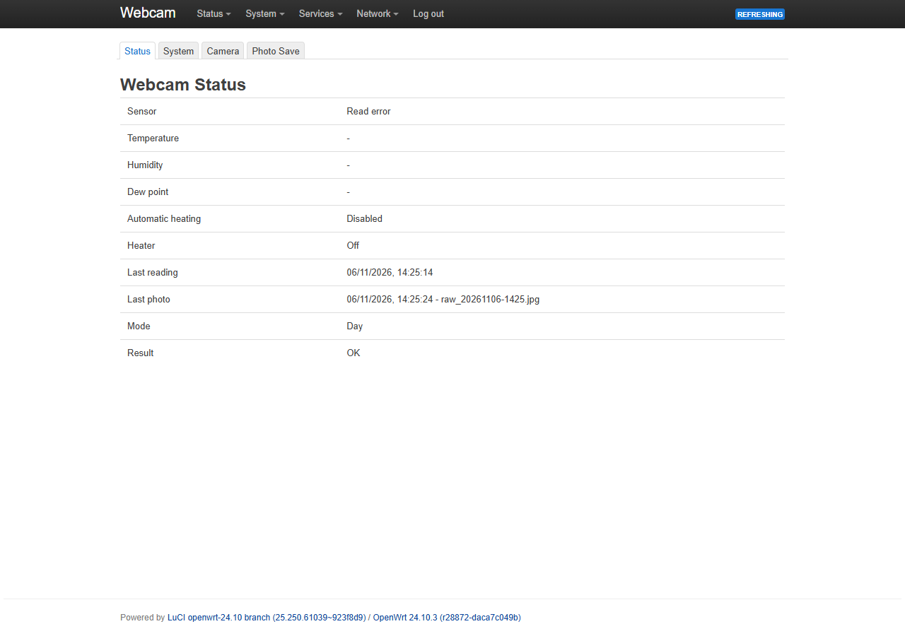
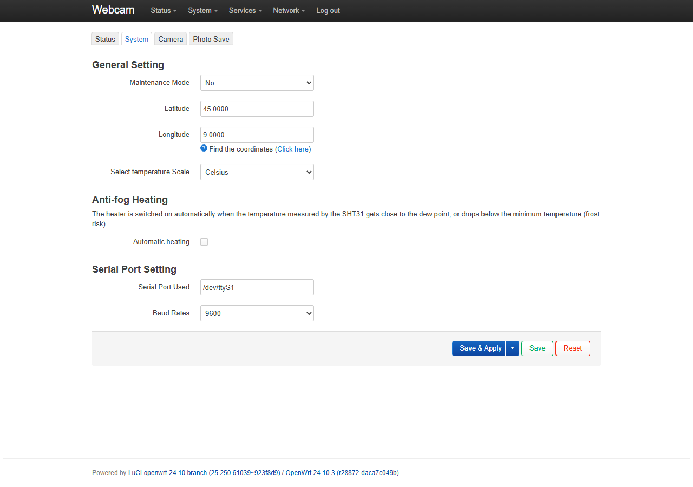
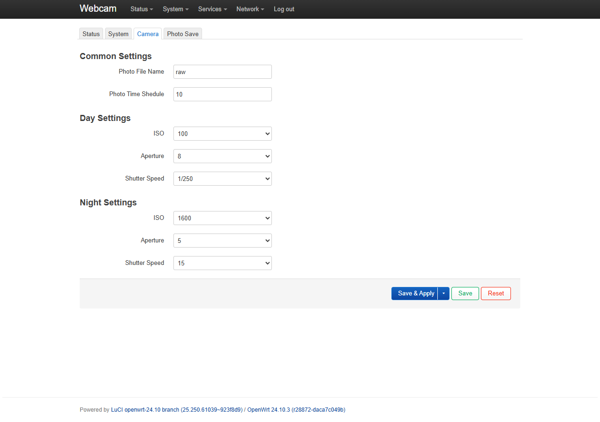
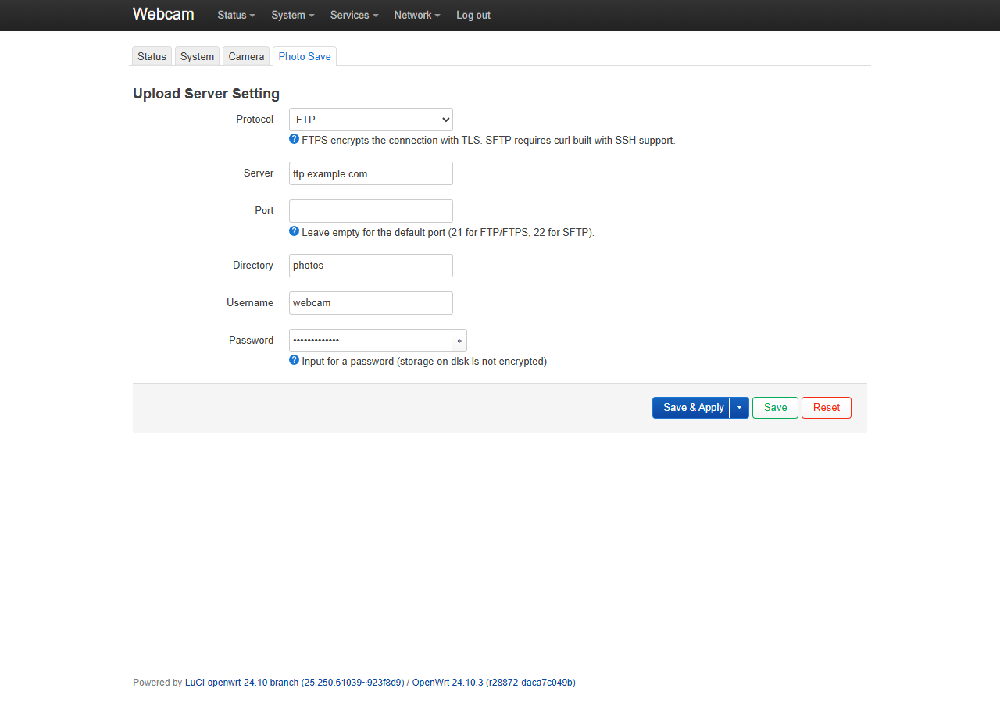

# luci-app-webcam

App LuCI per OpenWrt che trasforma un piccolo router (testata su **GL.iNet GL-MT300N-V2**) in una webcam time-lapse con una reflex **Canon EOS** collegata via USB.

- Scatta a intervalli regolari con **gPhoto2**, con impostazioni diverse per **giorno** e **notte**. Alba e tramonto sono calcolati in locale dalle coordinate.
- Carica ogni foto su un server **FTP**, **FTPS** o **SFTP**.
- Insieme a una scheda dedicata (ATmega328P) collegata in seriale:
  - comanda i relè di fotocamera, router, riscaldamento e ventola;
  - legge un sensore **SHT31/SHT35** e accende il riscaldamento per evitare condensa e brina sul vetro del case;
  - fa da **watchdog**: se il router smette di rispondere, toglie e ridà corrente a router e fotocamera.
- Se la fotocamera si blocca, la riavvia da sola tramite il relè.
- Avvisa tramite [healthchecks.io](https://healthchecks.io) quando una webcam smette di caricare foto, e può mandare i log di tutti i router a un unico server (vedi [webcam-logserver](https://github.com/Millorco/webcam-logserver)).



## Indice

- [Hardware](#hardware)
- [Installazione](#installazione)
- [Configurazione](#configurazione)
- [Come funziona](#come-funziona)
- [Scheda relè e sensore](#scheda-relè-e-sensore)
- [Monitoraggio e log centralizzati](#monitoraggio-e-log-centralizzati)
- [Risoluzione dei problemi](#risoluzione-dei-problemi)
- [Struttura del progetto](#struttura-del-progetto)

## Hardware

| Componente | Note |
|---|---|
| Router OpenWrt | GL.iNet GL-MT300N-V2 (MT7628). Usa la seconda UART (`/dev/ttyS1`, pad TX1/RX1) per la scheda. |
| Fotocamera | Canon EOS 2000D / 1500D (altre EOS supportate da gPhoto2 dovrebbero funzionare). |
| Scheda "Webcam Board 1.0" | ATmega328P a 16 MHz, 3 relè (fotocamera, router, riscaldamento), uscita ventola, traslatori di livello 5 V ↔ 3,3 V verso il router, convertitori per 5 V e alimentazione fotocamera. |
| Sensore | SHT31 o SHT35 su I2C (indirizzo 0x44 o 0x45). |

Collegamenti principali:

| Connettore scheda | Pin | Collegamento |
|---|---|---|
| **TX1** (verso il router) | 1 VCC · 2 RX1OUT · 3 TX1OUT | VCC = 3,3 V del router · RX1OUT → TX1 del router · TX1OUT → RX1 del router. La massa arriva dall'alimentazione. |
| **TEMP** (sensore) | 1 5V · 2 GND · 3 SCL · 4 SDA | Attenzione ai moduli **Grove**, che hanno un ordine diverso (SCL, SDA, VCC, GND): serve un cavo rimappato. |
| **FTDI** (debug e programmazione) | 1 GND · 2 TX · 3 RX · 4 5V · 5 DTR | TX → RXD dell'adattatore, RX → TXD dell'adattatore. |

## Installazione

Sul router, via SSH:

```sh
wget https://raw.githubusercontent.com/Millorco/luci-app-webcam/main/install.sh
chmod +x install.sh
./install.sh
```

Lo script:
1. mostra le release disponibili e chiede quale installare;
2. installa o aggiorna le dipendenze (`gphoto2`, `libgphoto2-drivers-ptp2`, `curl`, `coreutils-stty`);
3. copia i file. Se esiste già una configurazione, chiede se sovrascriverla;
4. abilita e avvia il servizio `webcam_capture`. Il servizio aggiunge al crontab di root, senza toccare gli altri job, l'heartbeat (ogni 3 minuti) e il controllo anti-appannamento (ogni 5 minuti).

Dopo l'installazione, con la fotocamera collegata e accesa, genera gli elenchi di ISO, diaframmi e tempi che compaiono nei menu di LuCI:

```sh
iso_export; aperture_export; shutterspeed_export
```

L'elenco dei diaframmi dipende dall'obiettivo e dallo zoom: rilancia `aperture_export` se li cambi.

## Configurazione

Le pagine sono in **Servizi → Webcam**. La configurazione è salvata in `/etc/config/webcam`.

### Status

Mostra la versione dell'app e del firmware della scheda (letta con il comando `v`), temperatura, umidità, punto di rugiada, stato del riscaldamento, ultimo scatto (giorno/notte) ed esito dell'upload. Si aggiorna ogni 30 secondi; i dati della scheda ogni 5 minuti.

Sotto la tabella ci sono tre pulsanti:

- **Take photo now**: scatta subito con le impostazioni attuali e carica la foto come uno scatto normale.
- **Test shot (no upload)**: scatta ma non carica nulla, per provare esposizione e messa a fuoco.
- **Show last photo**: mostra l'ultima foto rimasta sul router.

Funzionano anche in modalità manutenzione. Dopo lo scatto la pagina mostra l'anteprima e un link alla foto a piena risoluzione. La foto resta in `/tmp/webcam/photo` solo fino allo scatto successivo, e l'anteprima scarica il file originale, quindi con una reflex da 24 MP può impiegare qualche secondo. Se uno scatto è già in corso (anche quello programmato), il pulsante lo segnala e non ne avvia un altro.

### System



- **Maintenance Mode**: con *Yes* il servizio non scatta. Dopo l'installazione è attivo: mettilo su *No* quando hai finito di configurare.
- **Latitudine / Longitudine**: servono per calcolare alba e tramonto.
- **Wait for NTP**: minuti massimi di attesa della sincronizzazione dell'ora dopo un riavvio (predefinito 30, 0 = senza limite). Vedi [Ora dopo un riavvio](#ora-dopo-un-riavvio).
- **Temperature scale**: °C o °F nella pagina Status.
- **Anti-fog Heating**: abilita il controllo automatico e ne imposta le soglie (margine dal punto di rugiada, temperatura minima, isteresi, ventola insieme al riscaldamento).
- **Monitoring**: URL di ping di [healthchecks.io](https://healthchecks.io), vedi [Monitoraggio e log centralizzati](#monitoraggio-e-log-centralizzati).
- **Serial Port**: `/dev/ttyS1` a 9600 baud per la scheda.

### Camera



- **Photo File Name**: prefisso del file (`<prefisso>_AAAAMMGG-HHMM.jpg`).
- **Photo Time Schedule**: intervallo tra gli scatti, in minuti.
- **Sunrise / Sunset offset**: minuti (anche negativi) che spostano il passaggio tra impostazioni diurne e notturne. Con *−30* e *+30* le impostazioni diurne valgono da mezz'ora prima dell'alba a mezz'ora dopo il tramonto, quando il cielo è ancora chiaro e le impostazioni notturne brucerebbero la foto.
- **Special capture times**: fasce orarie con un intervallo diverso, per esempio ogni minuto dalle 23:50 alle 00:10 di Capodanno, o più fitto al tramonto. Per ogni fascia: data (vuota = ogni giorno, `MM-GG` = ogni anno, `AAAA-MM-GG` = una volta sola), inizio e fine `HH:MM` e intervallo in minuti. L'intervallo sostituisce quello normale, quindi può anche diradare gli scatti (es. ogni 30 minuti di notte); se più fasce si sovrappongono vale la più fitta. Una fascia che passa la mezzanotte appartiene al giorno in cui inizia. Il servizio si sveglia all'inizio e alla fine di ogni fascia, così il primo scatto non arriva in ritardo.
- **Day / Night Settings**: ISO, diaframma e tempo. *Camera setting (do not change)* lascia l'impostazione della fotocamera, comodo in modalità P o Av. Il tempo **bulb** non viene mai applicato.

Consigli per una webcam fissa:
- **Messa a fuoco manuale**: metti a fuoco una volta sulla scena, poi sposta l'interruttore dell'obiettivo su **MF**. In AF la fotocamera rifiuta lo scatto ("PTP Device Busy") quando non riesce a mettere a fuoco, per esempio con nebbia o di notte.
- **Esposizione**: con la ghiera su **M** imposta valori espliciti per giorno e notte (ad esempio giorno 1/250, f/8, ISO 100 e notte 15", f/5, ISO 1600). Con **Av/P** lascia i campi su *do not change*.

### Photo Save



- **Protocol**: FTP, FTPS (FTP su TLS, consigliato se il server lo supporta) o SFTP. SFTP richiede un `curl` compilato con libssh2: verifica con `curl -V`.
- **Server, porta, cartella, utente e password**. Per SFTP si può indicare una chiave privata al posto della password.
- **Skip certificate check**: solo per certificati self-signed. Se il certificato è valido ma intestato a un altro nome (tipico degli hosting condivisi), usa come server il nome presente nel certificato.

Archivio e file aggiuntivi (tutti disattivati di default):

- **Folders by date**: salva ogni foto in `<cartella>/AAAA/MM/GG/`, create in automatico. È lo schema usato da foto-webcam.eu e da gallerie pronte come [webcam.php](https://github.com/cloveras/webcam).
- **Upload a copy as latest photo**: carica la foto anche come `<cartella>/current.jpg` (nome modificabile), sostituita a ogni scatto, comoda da mostrare in una pagina web. Viaggia come `current.jpg.part` e viene rinominata solo a upload finito, quindi chi apre la pagina vede sempre una foto intera (per un istante, tra la cancellazione della vecchia e la rinomina, il file può mancare). La foto viene inviata due volte, quindi il traffico raddoppia. Se solo la copia fallisce, l'esito nella pagina Status lo dice ma la foto in archivio resta caricata.
- **Upload data file**: accanto a ogni foto carica un `.json` con lo stesso nome, e `current.json` se è attiva la copia. Esempio:

```json
{
  "time": 1794058231,
  "datetime": "2026-11-07T14:30:31+0100",
  "camera": "webcam",
  "file": "webcam_20261107-1430.jpg",
  "mode": "day",
  "special": null,
  "settings": { "iso": "100", "aperture": null, "shutterspeed": null },
  "day_start": 1794028774,
  "day_end": 1794068884,
  "app_version": "1.0-beta3",
  "climate": { "time": 1794058200, "sensor_ok": true, "temperature": 12.3, "humidity": 80,
               "dewpoint": 9.0, "heating_enabled": true, "heater": false, "board_fw": "2.2" }
}
```

  `null` nelle impostazioni significa "lasciata quella della fotocamera". `day_start`/`day_end` sono alba e tramonto già spostati dagli offset. `climate` è l'ultima lettura di `climate` (null se più vecchia di 15 minuti). Con questi file il server può fare grafici, sovrimpressioni o allarmi senza interrogare il router.

Coda offline:

- **Queue size (MB)**: le foto che non si riescono a caricare (4G assente, server giù) restano sul router e vengono ritentate agli scatti successivi, dopo la foto nuova e dalla più vecchia, ognuna nella cartella del giorno in cui è stata scattata. Ogni giro dedica alla coda al massimo metà intervallo (e non più di 5 minuti), e si ferma al primo upload fallito. Quando la coda supera il limite, o nel filesystem restano meno di 8 MB liberi, vengono cancellate le foto più vecchie; la più recente resta sempre. Predefinito 20 MB, 0 disattiva la coda. La pagina Status mostra quante foto sono in attesa.
- **Queue folder**: vuota = `/tmp/webcam/queue`, in RAM, persa a ogni riavvio. Con 128 MB di RAM ci stanno due o tre foto da 24 MP. Per una coda più lunga usa una chiavetta USB: crea prima la cartella (es. `/mnt/sda1/webcam-queue`) e indicala qui. Se la cartella non esiste, per esempio perché la chiavetta non è montata, la coda torna in RAM, così non si scrive nella flash del router.

### Ora dopo un riavvio

Il GL-MT300N-V2 non ha un orologio a batteria: dopo ogni riavvio, compresi i cicli del watchdog e i blackout, l'ora riparte da quella dell'ultimo file salvato in flash. Per non caricare foto con data vecchia, che finirebbero nella cartella sbagliata e potrebbero sovrascrivere sul server una foto con lo stesso nome, all'avvio `capture_service` non scatta finché `sysntpd` non ha sincronizzato l'ora. Lo segnala `/etc/hotplug.d/ntp/25-webcam`, che crea `/var/run/webcam_ntp_synced`.

- Se dopo *Wait for NTP* minuti l'ora non è ancora sincronizzata, scatta comunque, lo scrive nel log e nel registro del check di healthchecks.io.
- Se l'anno è precedente al 2025 l'ora è sicuramente sbagliata: non scatta finché non arriva NTP, e anche "Take photo now" rifiuta l'upload (lo scatto di prova funziona).
- Se il client NTP è disattivato in *Sistema → Sistema → Sincronizzazione dell'ora*, non aspetta. Lascialo attivo.

## Come funziona

- **`capture_service`** (servizio procd `webcam_capture`): all'avvio aspetta che l'ora sia sincronizzata con NTP, poi ogni *Photo Time Schedule* minuti lancia `capture`, salvo in modalità manutenzione. Durante una fascia speciale usa l'intervallo della fascia (calcolato da `/usr/libexec/webcam/schedule`).
- **`capture`**:
  1. decide se è giorno o notte con `sun_times`, applicando gli offset di alba e tramonto;
  2. spegne il riscaldamento durante lo scatto, per avere abbastanza corrente;
  3. scatta con gphoto2 usando `--set-config-index`;
  4. se lo scatto fallisce, spegne e riaccende la fotocamera tramite la scheda e riprova una volta;
  5. mette la foto nella coda offline e la carica (in `AAAA/MM/GG/` se richiesto) con il suo `.json` dei dati, poi la copia `current.jpg` con nome temporaneo e rinomina;
  6. se l'upload è riuscito toglie la foto dalla coda e ritenta quelle arretrate, poi scrive l'esito e il numero di foto in coda in `/tmp/webcam/capture.json`.
- **`climate`** (cron, ogni 5 minuti): legge T e RH, calcola il punto di rugiada (formula di Magnus) e accende riscaldamento e ventola se `T − Td` è sotto il margine o `T` è sotto la minima, con isteresi per lo spegnimento. Lo stato va in `/tmp/webcam/status.json`. Se il sensore non risponde, lo stato del riscaldamento resta invariato.
- **`heartbeat`** (cron, ogni 3 minuti): invia `b` alla scheda. Dopo 10 minuti senza heartbeat la scheda spegne e riaccende router e fotocamera.
- **`/usr/libexec/webcam/serial`**: unico punto di accesso alla seriale, con lock e una pausa di 2 secondi tra un comando e l'altro.

## Scheda relè e sensore

Firmware: [`board.ino`](board.ino) (versione 2.1).

### Protocollo

9600 baud 8N1, un carattere per comando, senza terminatore. Funziona uguale dal router e dall'FTDI.

| Comando | Azione | Risposta |
|---|---|---|
| `b` | heartbeat | — |
| `C` / `c` | fotocamera ON / OFF | — |
| `H` / `h` | riscaldamento ON / OFF | — |
| `P` / `p` | router ON / OFF | — |
| `F` / `f` | ventola ON / OFF | — |
| `t` | temperatura | es. `21.4`, oppure `ERR` |
| `u` | umidità | es. `55.0`, oppure `ERR` |
| `d` | test connessione | `OK` |
| `r` | ciclo di alimentazione di router e fotocamera (5 s) | — |
| `s` | stato su una riga | `S fw=2.2 camera=1 heating=0 pc=1 fan=0 sht=1 T=… H=… hb_age=… wd=1 cycles=…` |
| `v` | versione | `Webcam Board fw 2.2` |
| `?` | elenco comandi | — |
| `i` | *(solo FTDI)* scansione del bus I2C | — |
| `w` / `W` | *(solo FTDI)* sospende per 60 minuti / riattiva il watchdog dell'heartbeat | — |

Sicurezze integrate nel firmware:
- **Riscaldamento e ventola** si spengono da soli se `H`/`F` non vengono ripetuti entro 20 minuti (`climate` li reinvia ogni 5). Il riscaldamento si spegne anche oltre i 45 °C o se il sensore resta muto.
- **Router che non riparte**: i cicli di alimentazione si diradano (10, 20, 40 minuti, fino a 2 ore).
- **Bus I2C**: ha un timeout, quindi un sensore guasto non blocca la scheda.
- **Watchdog hardware AVR** a 8 secondi.

### Programmazione

1. Arduino IDE: scheda **Arduino Uno**, libreria **Adafruit SHT31** (con Adafruit BusIO).
2. Su un chip nuovo, o se l'FTDI non riesce a caricare, scrivi prima il bootloader dal connettore **ICSP** (USBasp o "Arduino as ISP", *Strumenti → Scrivi il bootloader*). Poi carica lo sketch dall'FTDI, oppure direttamente con il programmatore.

### Debug

Apri il monitor seriale sull'FTDI a **9600 baud**, senza fine riga.

All'avvio la scheda stampa:
- la versione;
- la causa del reset (accensione, RESET/DTR, brown-out, watchdog);
- i livelli di SDA/SCL;
- la scansione I2C;
- lo stato del sensore.

Poi registra con timestamp ogni comando ricevuto e ogni cambio dei relè, e ogni minuto stampa una riga di stato.

## Monitoraggio e log centralizzati

- **Avvisi**: crea un check su [healthchecks.io](https://healthchecks.io) per ogni webcam, con *Period* uguale all'intervallo di scatto e *Grace time* almeno doppio, e copia il ping URL in **System → Monitoring**. Il router fa un ping dopo ogni foto caricata e un ping `/fail` con il messaggio a ogni errore. Scrive nel registro del check anche gli avvii del servizio (con l'uptime, per vedere i riavvii) e la modalità manutenzione. Se il router si spegne, l'allarme arriva alla fine del grace time.
- **Log**: OpenWrt può mandare il suo log a un server syslog (**System → System → Logging**). Il server con VictoriaLogs (Docker), con o senza VPN, è nel repository [webcam-logserver](https://github.com/Millorco/webcam-logserver). La VPN WireGuard a stella è in [webcam-vpn](https://github.com/Millorco/webcam-vpn): i router si collegano al VPS, tu ti colleghi dal PC e apri LuCI e SSH di ogni router (`http://webcam1.vpn`), anche in 4G. Sul router basta `central_log setup peer_<nome>.conf`, che crea il tunnel, apre dal tunnel solo SSH, LuCI e ping e manda lì il log (che VictoriaLogs riceve con la variante `wireguard/` di webcam-logserver).

## Risoluzione dei problemi

| Sintomo | Causa probabile | Cosa fare |
|---|---|---|
| `serial query d` non risponde | Scheda ferma o collegamento TX1 | Monitor FTDI: deve comparire il log di avvio. Controlla 3,3 V sul pin 1 di TX1 e i fili TX/RX incrociati. |
| `t`/`u` rispondono `ERR`, log "SDA=0 SCL=0" | Sensore non alimentato, cavo invertito (Grove) o sensore guasto | Scollega il sensore: se SDA/SCL tornano a 1 il problema è nel sensore o nel cavo. |
| Dopo un riavvio non scatta, log "Attendo la sincronizzazione dell'ora" | NTP non raggiungibile (rete assente o porta UDP 123 bloccata) | Controlla la connessione e il client NTP in *Sistema → Sistema*. Dopo *Wait for NTP* minuti scatta comunque. |
| Foto in coda che non si svuota | Upload che fallisce, o coda più grande di quanto si carica in mezzo intervallo | Guarda l'errore nell'esito dello scatto. Su 4G lento riduci la dimensione JPEG della fotocamera o allunga l'intervallo. |
| Scatti con "PTP Device Busy" | Autofocus che non aggancia | Obiettivo su **MF**. |
| Scatti con "I/O in progress" / "PTP General Error" | Tempo impostato su bulb o fotocamera bloccata | Imposta un tempo reale. La fotocamera viene riavviata in automatico. |
| FTPS: "certificate Common Name does not match" | Hosting condiviso con certificato a nome del server | Usa come server il nome del certificato (es. `ftplnxNN.aruba.it`). |

Log utili sul router:

```sh
logread | grep -iE 'capture|climate'
cat /tmp/webcam/capture.json /tmp/webcam/status.json
/usr/libexec/webcam/serial query s
```

## Struttura del progetto

```
.
├── board.ino                                  firmware della scheda
├── install.sh                                 installazione da release GitHub
├── htdocs/luci-static/resources
│   ├── view/webcam/                           pagine LuCI
│   │   ├── status.js                          stato, ultimo scatto, "Scatta ora" e anteprima
│   │   ├── system_setting.js                  generale, anti-appannamento, monitoraggio, seriale
│   │   ├── camera_setting.js                  intervallo, fasce speciali, esposizione giorno/notte
│   │   └── up_server.js                       server di upload, archivio, file aggiuntivi
│   └── webcam/*_data.json                     scelte di ISO/diaframma/tempo (generate)
└── root
    ├── etc/config/webcam                      configurazione UCI
    ├── etc/init.d/webcam_capture              servizio procd + job cron
    ├── etc/hotplug.d/ntp/25-webcam            segnala l'ora sincronizzata con NTP
    ├── usr/bin/
    │   ├── capture, capture_service           scatto e ciclo di scatto
    │   ├── capture_now                        scatto manuale dalla pagina Status
    │   ├── central_log                        VPN WireGuard: log remoto, LuCI/SSH
    │   ├── climate                            anti-appannamento
    │   ├── heartbeat, serialsend, read_temp   comandi verso la scheda
    │   ├── iso_export, aperture_export,
    │   │   shutterspeed_export                generano i *_data.json dalla fotocamera
    │   ├── check_camera_model                 rigenera i JSON se cambia fotocamera
    │   ├── add_led_config                     spegne i LED del router
    │   └── webcam.cfg                         legge la configurazione UCI
    ├── usr/libexec/webcam/
    │   ├── serial                             accesso seriale con lock
    │   ├── schedule                           fasce orarie speciali
    │   ├── hc_ping                            ping a healthchecks.io
    │   └── sun_times                          calcolo locale di alba e tramonto
    └── usr/share/
        ├── luci/menu.d/luci-app-webcam.json   menu
        └── rpcd/acl.d/luci-app-webcam.json    permessi
```

## Licenza

GPL-2.0
